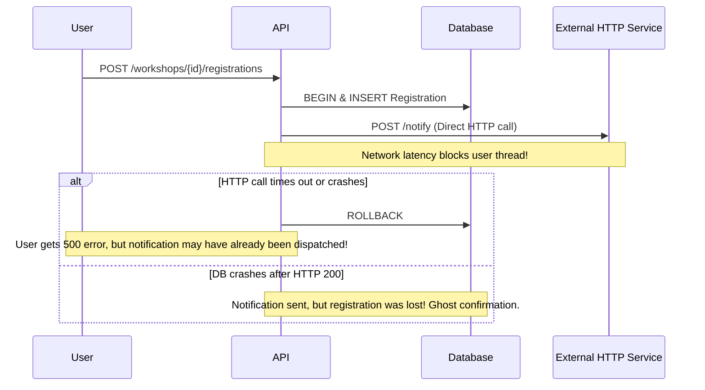
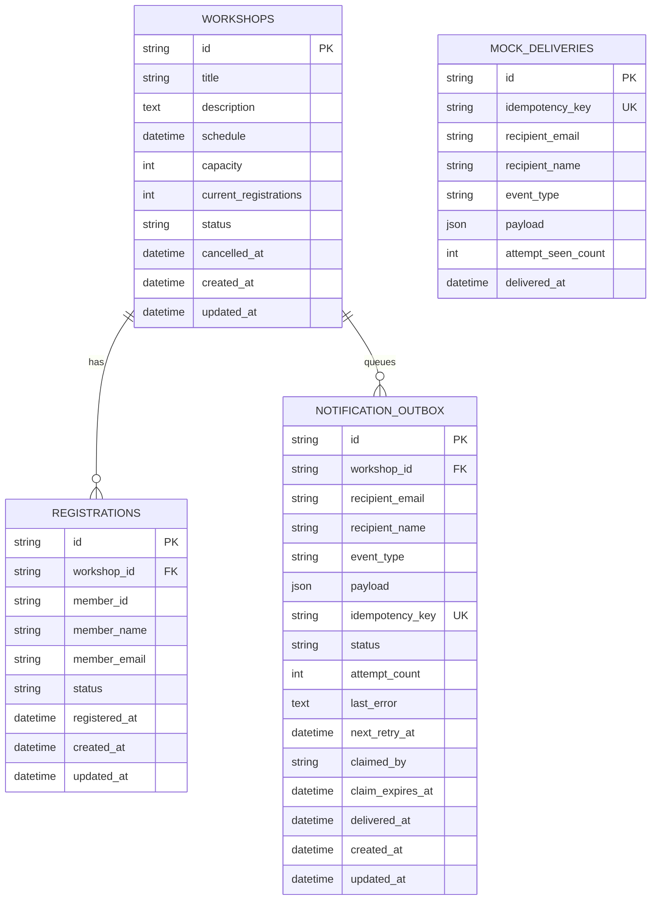

# EchoLet — Production-Quality Workshop Registration & Reliable Notification System

[](https://github.com/S-T-HARINI/Echolet)
[](https://microservices.io/patterns/data/transactional-outbox.html)
[](https://fastapi.tiangolo.com)
[](https://www.postgresql.org)
[](LICENSE)

EchoLet is a robust, production-grade implementation of the **GDG Tech Wildcard Entry — Backend Development (Task 2: Workshop Registration and Notifications)**. It guarantees durable, reliable notification delivery by eliminating the classic distributed dual-write failure mode through the **Transactional Outbox Pattern**, concurrency-safe worker leases, and receiver-side idempotency deduplication.

---

## Table of Contents
1. [Problem Statement & The Dual-Write Hazard](#1-problem-statement--the-dual-write-hazard)
2. [Architecture Overview & Component Responsibilities](#2-architecture-overview--component-responsibilities)
3. [Technology Stack Rationale](#3-technology-stack-rationale)
4. [Database Schema & Transaction Boundaries](#4-database-schema--transaction-boundaries)
5. [Transactional Outbox Workflow](#5-transactional-outbox-workflow)
6. [Worker Job Claiming, Retries, and Recovery](#6-worker-job-claiming-retries-and-recovery)
7. [Idempotency & Ambiguous Delivery Outcomes](#7-idempotency--ambiguous-delivery-outcomes)
8. [Workshop Cancellation Fan-Out](#8-workshop-cancellation-fan-out)
9. [Standalone Mock HTTP Notification Service](#9-standalone-mock-http-notification-service)
10. [Local Development & Docker Deployment](#10-local-development--docker-deployment)
11. [API Reference & Example Curl Commands](#11-api-reference--example-curl-commands)
12. [Step-by-Step Demonstration Workflows](#12-step-by-step-demonstration-workflows)
13. [Automated Testing Suite](#13-automated-testing-suite)
14. [Engineering Trade-offs & Known Limitations](#14-engineering-trade-offs--known-limitations)

---

## 1. Problem Statement & The Dual-Write Hazard

In workshop registration systems, a user registration requires two logical outcomes:
1. Persisting the registration in a relational database.
2. Sending a confirmation notification (e.g., via email, SMS, or an external webhook).

### The Flawed "Direct HTTP" Pattern


### The EchoLet Transactional Outbox Solution
EchoLet decomposes registration and delivery into two decoupled, resilient phases:
1. **Phase 1 (Synchronous & Atomic)**: The registration and a pending notification event are committed within the **exact same database transaction**. The API returns HTTP 201 immediately without making external network calls.
2. **Phase 2 (Asynchronous & Fault-Tolerant)**: An independent notification worker continuously claims pending outbox events using PostgreSQL concurrency-safe leases (`FOR UPDATE SKIP LOCKED`), dispatches them over HTTP with bounded timeouts, handles retries with exponential backoff and jitter, and updates delivery state.

---

## 2. Architecture Overview & Component Responsibilities

```mermaid
flowchart TD
    Client["Client / Next.js Dashboard"]
    API["FastAPI Backend Service (:8000)"]
    DB[("PostgreSQL Database (:5432)")]
    Worker["Outbox Worker Daemon"]
    MockService["Mock HTTP Notification Service (:8001)"]

    Client -->|"POST /api/v1/workshops/{id}/registrations"| API
    Client -->|"POST /api/v1/workshops/{id}/cancel"| API

    subgraph Atomic_Tx ["Atomic Relational Transaction"]
        API -->|"1. Persist Registration"| DB
        API -->|"2. Persist NotificationOutbox (PENDING)"| DB
    end

    API -->|"201 Created (Instant)"| Client

    Worker -->|"Poll & Claim (FOR UPDATE SKIP LOCKED)"| DB
    Worker -->|"POST /api/v1/notify (Bounded 3s Timeout)"| MockService
    MockService -->|"200 OK / 5xx / Timeout"| Worker

    alt Success (200 OK with 'delivered')
        Worker -->|"status = DELIVERED, delivered_at = NOW"| DB
    else Transient HTTP Error or Timeout
        Worker -->|"status = RETRYING, Backoff + Jitter"| DB
    end
```

### Component Roles:
- **`backend` (FastAPI)**: Validates input schemas, enforces workshop capacities and duplicate constraints atomically, persists registrations and outbox events, and exposes inspection endpoints.
- **`worker` (Python Daemon)**: Concurrency-safe outbox processor. Claims jobs with lease timeouts, executes bounded HTTP requests, and safely recovers crashed worker claims.
- **`mock_service` (FastAPI Service)**: Standalone HTTP recipient with its own persistent SQLite database for deliveries, deterministic failure controls (500 errors, timeouts, flaky mode), and receiver-side idempotency deduplication.
- **`frontend` (Next.js & Tailwind CSS)**: Engineering dashboard adhering to a monochrome, Linear/Raycast/Vercel design system with light/dark/system mode and brightness adjustments.

---

## 3. Technology Stack Rationale

| Component | Selected Technology | Technical Justification |
| :--- | :--- | :--- |
| **Language** | Python 3.12 / 3.13 | Native async/await, broad ecosystem, high developer productivity. |
| **Web Framework** | FastAPI | High throughput async ASGI, automatic OpenAPI generation, Pydantic validation. |
| **Validation** | Pydantic v2 | High-performance C-extension validation, strict typing, ISO-8601 UTC enforcement. |
| **ORM / Query Engine** | SQLAlchemy 2.0 (Async) | Async session management, cross-database support (PostgreSQL & SQLite for tests). |
| **Persistence** | PostgreSQL 16 | Durable ACID transactions, row-level locking (`FOR UPDATE SKIP LOCKED`). |
| **Migrations** | Alembic | Tracked, reproducible schema evolution without automatic table hacks. |
| **HTTP Client** | HTTPX | Asynchronous HTTP client with bounded timeouts and connection pooling. |
| **Testing** | Pytest & pytest-asyncio | 24 automated unit, concurrency, idempotency, and failure-recovery tests. |
| **Frontend** | Next.js 14, React, Tailwind | Minimalist monochrome engineering dashboard with live status inspection. |

---

## 4. Database Schema & Transaction Boundaries

### Relational Schema Diagram


### Critical Database Constraints & Indexes:
1. **Unique Registration Constraint**: `uq_registrations_workshop_member (workshop_id, member_id)` prevents double registration at the database level.
2. **Deterministic Outbox Idempotency Key**: `uq_notification_outbox_idempotency_key (idempotency_key)` ensures duplicate logical events cannot be inserted.
3. **Optimized Worker Polling Index**: `ix_outbox_polling (status, next_retry_at)` allows instant sub-millisecond retrieval of pending and retryable jobs.
4. **Crash Recovery Lease Index**: `ix_outbox_lease_expiry (status, claim_expires_at)` enables rapid claiming of abandoned jobs.

---

## 5. Transactional Outbox Workflow

### Atomic Registration Algorithm:
1. `SELECT 1 FROM registrations WHERE workshop_id = :id AND member_id = :member_id` verifies applicant has not registered.
2. **Atomic Capacity Reservation**:
   ```sql
   UPDATE workshops
   SET current_registrations = current_registrations + 1
   WHERE id = :id AND status = 'SCHEDULED' AND current_registrations < capacity;
   ```
   If updated rows == 0, registration is rejected with 409 (Capacity reached or workshop cancelled).
3. Insert `Registration` record (`status = 'CONFIRMED'`).
4. Insert `NotificationOutbox` record with `idempotency_key = f"reg_{registration.id}"` and `status = 'PENDING'`.
5. **COMMIT** the transaction.
6. Return HTTP 201 Created to client.

---

## 6. Worker Job Claiming, Retries, and Recovery

### Concurrency-Safe Claiming with Leases
Multiple worker instances can run concurrently across containers:
```sql
SELECT * FROM notification_outbox
WHERE (status IN ('PENDING', 'RETRYING') AND next_retry_at <= :now)
   OR (status = 'CLAIMED' AND claim_expires_at <= :now)
ORDER BY next_retry_at ASC
LIMIT :batch_size
FOR UPDATE SKIP LOCKED;
```
Once rows are selected, the worker sets `status = 'CLAIMED'`, `claimed_by = :worker_id`, and `claim_expires_at = :now + 30s`, and **commits immediately**.
> [!IMPORTANT]
> The database connection is released before the worker initiates the external HTTP call. No database connection is ever held open during network calls!

### Exponential Backoff with Jitter
When a transient HTTP error (500, 502, 503, 504) or timeout occurs:
$$ \text{delay} = \min(\text{max\_delay}, \text{base\_delay} \times 2^{\text{attempt\_count} - 1}) \times \text{Uniform}(0.5, 1.0) $$
- **Base delay**: 2.0s
- **Max delay**: 300.0s (5 minutes)
- Notifications are **never silently discarded**; transient failures continue retrying with capped delay.
- Each item is processed independently; one failing recipient does not block other recipients.

### Zombie Worker Crash Recovery
If a worker crashes mid-delivery:
- The item remains in state `CLAIMED`.
- After 30 seconds, `claim_expires_at <= NOW()` becomes true.
- Any active worker automatically reclaims the expired lease on the next polling cycle.

---

## 7. Idempotency & Ambiguous Delivery Outcomes

### The Ambiguous Timeout Problem
If the worker sends an HTTP request, the mock service records the delivery, but the network connection drops before the 200 OK response reaches the worker:
1. The worker records a timeout and marks the event `RETRYING`.
2. When the retry executes, the worker re-sends the request with the **exact same `idempotency_key`** (`reg_UUID`).
3. The Mock Notification Service checks its durable `mock_deliveries` table:
   ```sql
   SELECT * FROM mock_deliveries WHERE idempotency_key = :key;
   ```
4. If found, it increments `attempt_seen_count` and returns:
   ```json
   {
     "status": "delivered",
     "idempotent_replay": true,
     "delivery_id": "...",
     "message": "Notification already delivered previously (idempotent deduplication)."
   }
   ```
5. The worker updates its outbox record to `DELIVERED`.
6. **Result**: Exactly one logical delivery record is stored in durable receiver storage.

---

## 8. Workshop Cancellation Fan-Out

When an organizer cancels a workshop (`POST /api/v1/workshops/{id}/cancel`):
1. The workshop row is locked. If already `CANCELLED`, the endpoint returns HTTP 200 with `notifications_queued: 0` (Idempotent).
2. Workshop status is updated to `CANCELLED` and `cancelled_at` is set.
3. All confirmed registrations for that workshop are fetched.
4. For each registration, a cancellation outbox event is created with deterministic idempotency key `cancel_{workshop_id}_{reg_id}`.
5. All operations commit within the same atomic transaction.
6. Subsequent registration attempts are rejected with HTTP 400.

---

## 9. Standalone Mock HTTP Notification Service

The Mock Service (`mock_service`) runs as an independent HTTP server on port 8001:
- `POST /api/v1/notify`: Accepts notification dispatch. Validates payload, evaluates failure injection rules, checks receiver idempotency, and records delivery.
- `GET /api/v1/deliveries`: Inspects recorded deliveries.
- `POST /api/v1/simulate/configure`: Configures simulation modes (`normal`, `fail_500`, `timeout`, `flaky`, `fail_recipients`).
- `POST /api/v1/simulate/reset`: Resets simulator to normal mode.
- `GET /api/v1/simulate/status`: Returns current failure configuration and statistics.

---

## 10. Local Development & Docker Deployment

### Option A: Docker Compose (Recommended)
Starts PostgreSQL, Mock Service, Backend API, Worker Daemon, and Next.js Frontend:
```bash
docker-compose up --build
```
- Backend API: `http://localhost:8000`
- API Documentation: `http://localhost:8000/docs`
- Mock Service: `http://localhost:8001`
- Frontend Dashboard: `http://localhost:3000`

### Option B: Local Development (Without Docker)

#### 1. Setup Python Virtual Environment:
```bash
python -m venv .venv
# Windows:
.venv\Scripts\activate
# Linux/macOS:
source .venv/bin/activate

pip install -r requirements.txt
```

#### 2. Run Database Migrations:
```bash
alembic upgrade head
```

#### 3. Start Mock Notification Service (Terminal 1):
```bash
python -m uvicorn mock_service.app.main:app --port 8001 --reload
```

#### 4. Start EchoLet Backend API (Terminal 2):
```bash
python -m uvicorn backend.app.main:app --port 8000 --reload
```

#### 5. Start Outbox Notification Worker (Terminal 3):
```bash
python -m backend.app.worker.runner
```

#### 6. Start Next.js Frontend Dashboard (Terminal 4):
```bash
cd frontend
npm install
npm run dev
```

---

## 11. API Reference & Example Curl Commands

### Workshop Management
```bash
# 1. Create a Workshop
curl -X POST http://localhost:8000/api/v1/workshops \
  -H "Content-Type: application/json" \
  -d '{
    "title": "Cloud-Native Architecture",
    "description": "Mastering outbox patterns and distributed data consistency",
    "schedule": "2026-11-20T14:00:00Z",
    "capacity": 25
  }'

# 2. List Workshops
curl -X GET http://localhost:8000/api/v1/workshops

# 3. Get Workshop Details
curl -X GET http://localhost:8000/api/v1/workshops/<WORKSHOP_ID>
```

### Member Registration
```bash
# 4. Register a Member (Returns immediately with notification_status: PENDING)
curl -X POST http://localhost:8000/api/v1/workshops/<WORKSHOP_ID>/registrations \
  -H "Content-Type: application/json" \
  -d '{
    "member_id": "mem-101",
    "member_name": "Alice Smith",
    "member_email": "alice@example.com"
  }'

# 5. List Registrations for Workshop
curl -X GET http://localhost:8000/api/v1/workshops/<WORKSHOP_ID>/registrations
```

### Workshop Cancellation Fan-Out
```bash
# 6. Cancel Workshop (Queues cancellation notifications for all registered members)
curl -X POST http://localhost:8000/api/v1/workshops/<WORKSHOP_ID>/cancel
```

### Outbox & Health Inspection
```bash
# 7. Outbox Summary
curl -X GET http://localhost:8000/api/v1/notifications/summary

# 8. List Outbox Notifications (Filter by status, workshop, or recipient)
curl -X GET "http://localhost:8000/api/v1/notifications?status=DELIVERED"

# 9. Get Single Notification Details
curl -X GET http://localhost:8000/api/v1/notifications/<NOTIFICATION_ID>

# 10. System Health Check
curl -X GET http://localhost:8000/api/v1/health
```

---

## 12. Step-by-Step Demonstration Workflows

### Demo 1: Successful Registration & Async Delivery
1. Create a workshop with capacity = 10.
2. Register member `alice@example.com`.
3. Observe API response returns HTTP 201 with `notification_status: "PENDING"` immediately.
4. Worker claims event, dispatches to Mock Service.
5. Check `GET /api/v1/notifications/<id>`: status changes to `DELIVERED` with `delivered_at` timestamp.

### Demo 2: Simulating Failure & Recovery
1. Configure Mock Service to fail with HTTP 500:
   ```bash
   curl -X POST http://localhost:8001/api/v1/simulate/configure \
     -H "Content-Type: application/json" \
     -d '{"mode": "fail_500"}'
   ```
2. Register member `bob@example.com`.
3. Check outbox: status is `RETRYING`, `attempt_count: 1`, `last_error: "HTTP 500: ..."` with `next_retry_at` scheduled.
4. Reset Mock Service to normal:
   ```bash
   curl -X POST http://localhost:8001/api/v1/simulate/reset
   ```
5. When `next_retry_at` arrives, worker dispatches again. Status transitions to `DELIVERED`.

### Demo 3: Simulating Recipient Isolation
1. Add `unlucky@example.com` to Mock Service targeted failure list.
2. Register `unlucky@example.com` and `lucky@example.com`.
3. Observe: `lucky@example.com` delivers successfully (`DELIVERED`), while `unlucky@example.com` enters exponential backoff (`RETRYING`). **Neither recipient blocks the other.**

### Demo 4: Workshop Cancellation Fan-Out
1. Create workshop and register 3 members.
2. Cancel workshop: `POST /api/v1/workshops/<id>/cancel`.
3. Response reports `notifications_queued: 3`.
4. Outbox inspector shows 3 distinct cancellation events dispatched to all 3 members.
5. Attempting new registration returns HTTP 400 (Workshop cancelled).

---

## 13. Automated Testing Suite

The project includes 24 tests verifying every reliability and fault-recovery scenario.

### Running Tests:
```bash
# Run full test suite
pytest -v tests

# Run tests with code coverage report
pytest --cov=backend.app --cov=mock_service.app tests
```

### Test Coverage Highlights:
- **`test_api_validation.py`**: Validates past dates, capacity bounds, empty titles, and RFC email format.
- **`test_registration_and_outbox.py`**: Verifies transactional atomicity, outbox generation, and duplicate rejection.
- **`test_concurrency_and_capacity.py`**: Verifies capacity enforcement under concurrent bursts.
- **`test_cancellation_fanout.py`**: Verifies transactional fan-out, cancellation rejection, and repeated cancellation idempotency.
- **`test_mock_notification_service.py`**: Verifies receiver idempotency deduplication, simulated HTTP 500, timeouts, and targeted failure.
- **`test_worker_reliability_and_retry.py`**: Verifies lease claiming, backoff calculation, expired claim recovery, and recipient isolation.
- **`test_failure_recovery.py`**: Verifies end-to-end failure, exponential retry, and recovery across process cycles.
- **`test_endpoints_and_health.py`**: Verifies health checks, summary counters, and query filters.

---

## 14. Engineering Trade-offs & Known Limitations

1. **At-Least-Once Delivery**: Due to the CAP theorem and the two-generals problem over HTTP, exactly-once delivery across network boundaries is impossible without receiver-side deduplication. EchoLet pairs at-least-once outbox delivery with receiver-side idempotency keys.
2. **Polling vs. PostgreSQL LISTEN/NOTIFY**: EchoLet uses indexed polling with `FOR UPDATE SKIP LOCKED`. While `LISTEN/NOTIFY` reduces polling latency, polling with leases is universally durable across worker restarts, network partitions, and container scaling.
3. **Continuous Retries vs. Dead-Letter Queues**: To prevent silent notification loss, EchoLet continues retrying transient errors with a capped exponential backoff (up to 300 seconds) rather than discarding notifications after a hard limit.
